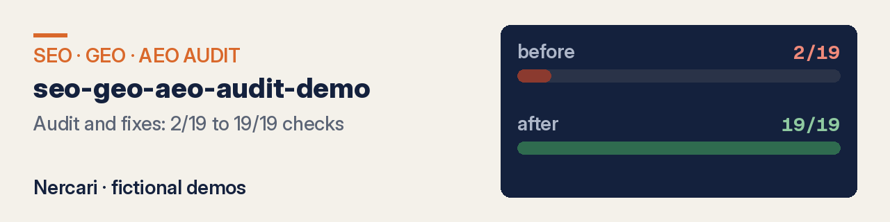
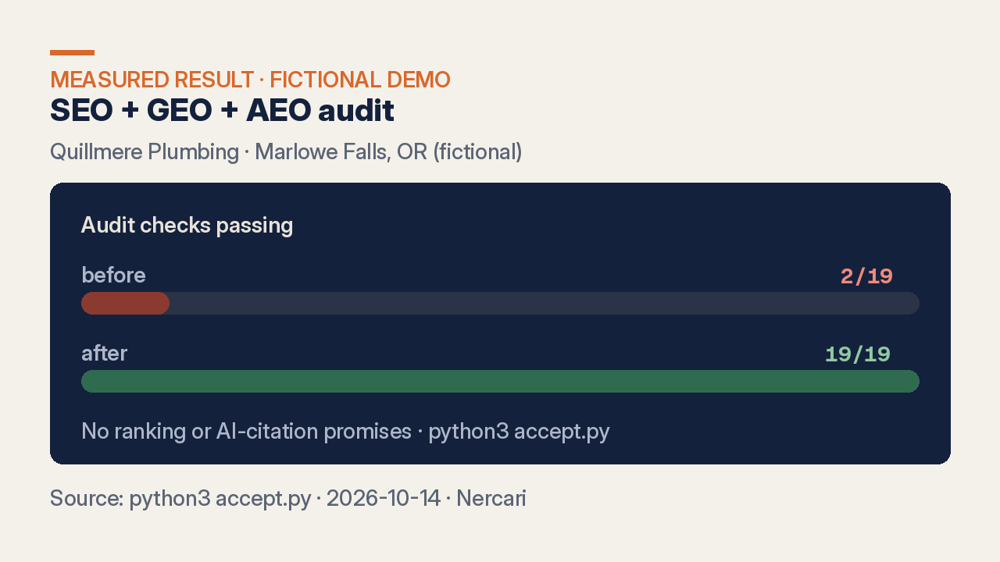

# SEO + GEO + AEO audit demo — measured, fictional demo by Nercari

**Audit and fixes: 2/19 to 19/19 checks.** A technical SEO and AI-answer readiness audit, the fixes, and a re-audit you can run yourself (`python3 accept.py`).

**Fiverr gigs coming soon** · **[See live demo](https://nercari.github.io/seo-geo-aeo-audit-demo/)**

## What you get

- An audit report with each failing check and how to fix it (`deliverable_example.md`)
- The fixes, written or applied: titles, meta, canonicals, alt text, headings (`demo/site_before/` → `demo/site_after/`)
- Schema markup (LocalBusiness, FAQPage) checked in the schema validator (`measurements/schema-validator-summary.txt`)
- `robots.txt` that allows AI crawlers, `sitemap.xml` and `llms.txt` (`demo/site_after/`)
- A re-audit with before vs after: 19 checks plus Lighthouse (`audit.py`, `accept.py`, `measurements/`)

Packages: AUDIT / AUDIT + FIXES / AUDIT, FIXES + FAQ (Fiverr gig coming soon).

## What did the fixes change?

### Local audit (`python3 accept.py`)

| | site_before | site_after |
|---|---|---|
| Checks passing | **2/19** | **19/19** |

### Lighthouse 13.5 (mobile, local server, index.html — `measurements/lighthouse-*.report.json`)

| Category | Before | After |
|---|---|---|
| Performance | 100 | 100 |
| Accessibility | 69 | 96 |
| Best Practices | 96 | 96 |
| SEO | 92 | 100 |

### Schema.org validator (validator.schema.org, all 4 pages — `measurements/schema-validator-summary.txt`)

| | Before | After |
|---|---|---|
| Schema objects found | 0 | 4 |
| Errors | 0 | 0 |
| Types | none | Plumber, FAQPage, Question/Answer, PostalAddress, OpeningHoursSpecification, Organization, Person, WebPage |

### Crawl and AI-answer readiness (`measurements/crawl-schema.json`)

| | Before | After |
|---|---|---|
| Pages found / broken links | 4 / 0 | 4 / 0 |
| Pages with canonical | 0/4 | 4/4 |
| AI crawlers allowed (GPTBot, OAI-SearchBot, ClaudeBot, PerplexityBot, Google-Extended) | blocked / missing | allowed |
| `llms.txt` | missing | present |

## How it works

1. You send the site URL (and a CMS login only if you order fixes applied).
2. `audit.py` runs the 19 checks and the report lists each failure with its fix.
3. The fixes are written or applied, depending on the package.
4. The re-audit (`accept.py`, Lighthouse, schema validator) shows before vs after.

## Live demo

[nercari.github.io/seo-geo-aeo-audit-demo](https://nercari.github.io/seo-geo-aeo-audit-demo/) — the full Quillmere Plumbing **after** site (title, meta, schema, sitemap, robots, `llms.txt`, visible fictional-demo banner) (`docs/pages/`).

## What this is and isn't

- **Sample data, labelled.** Quillmere Plumbing (Marlowe Falls, OR) is a fictional business in a fictional town, not client work (`SAMPLE-NOTES.md`). Numbers come from local runs dated **2026-10-14**.
- **Limits.** The audit measures on-site checks: tags, schema, crawlability, `llms.txt`. Rankings depend on competition, links and other factors outside the audit.
- **No guarantee.** No search ranking, traffic or AI citation is promised.
- **Secrets.** A CMS login is only needed for applied fixes and covers only the fixes you approve. Revoke it after delivery; it is never stored in a repo.

## FAQ

### Will my site rank #1 for my keywords?
This demo does not claim rankings. It shows measurable on-site checks (audit, Lighthouse, schema, crawlability, `llms.txt`).

### Can you publish the fixes on my CMS?
Yes, when you grant a CMS login for the fixes you approve.

## Docs

- `demo/site_before/` / `demo/site_after/` — the demo site before and after the fixes
- `audit.py` / `accept.py` — the 19-check auditor used in CI
- `deliverable_example.md` — sample audit report
- `measurements/` — Lighthouse reports and other run artifacts
- `docs/pages/` — the GitHub Pages copy of `demo/site_after` (with Nercari demo labelling)
- `llms.txt` — machine-readable summary for AI crawlers

Other showcases: [Claude skill examples](https://github.com/Nercari/claude-skill-examples) · [Claude Code setup](https://github.com/Nercari/claude-code-setup-example) · [Nercari profile](https://github.com/Nercari/Nercari)

Delivery-only through Fiverr. No video calls, voice or face content.
